# 00 · 耕云 App 开发思路图（长期愿景）

> **文档定位**：本文档描述的是**产品的完整长期设想（三期总览）**，**不是本期施工图**。
> 文中假设的团队规模（8-9 人，含全职农技专家）与周期（10-14 周）**不适用于当前阶段**——本团队实际为 3 名本科生 + 2 位兼职指导教师。
> **本期开发依据请见 [01-一期范围.md](01-一期范围.md)**，两者冲突时以一期范围为准。
>
> 归档日期：2026-10-02 ｜ 来源：团队研讨

> 版本 v1.1 ｜ 客户端：微信小程序 ｜ 范围：只做除草剂 ｜ 一期不做在线售药
> 

---

## 一、一句话说清这个产品

> 农民**拍张照**就知道地里是什么草、该用什么药，**听得见**配比和用量、**本地区**的杂草预警，还能在**社区**里问人。

**它不是"AI 识别 App"，它的四根支柱是：**

| 支柱        | 说明              | 对应设计                 |
| --------- | --------------- | -------------------- |
| ① 权威农药数据  | 数据不对，识别再准也是害人   | 农药库 + 审核专家 + 来源 + 版本 |
| ② 安全推荐规则  | 不让 AI 直接开药方     | 规则引擎 + 人工审核 + 禁用限用过滤 |
| ③ 语音友好交互  | 目标用户看字费劲，听得懂才会用 | 全局语音球 + 朗读本页 + 一键播报  |
| ④ 地区化智能推送 | "我这儿现在该防什么草"最值钱 | 地区—杂草—作物—方案 关联库      |

---

## 二、总览思路图（Mermaid，支持 Mermaid 的编辑器可直接渲染）

```mermaid
flowchart TB
    subgraph L0[" 一句话定位 "]
        P0["农民拍照认草认药 → 听得见用量 → 看得到本地预警 → 社区能问人"]
    end

    subgraph L1["① 用户看到什么：5 个 Tab + 1 个语音球 "]
        T1["除草剂分类<br/>高危/低危/生态"]
        T2["社区<br/>推荐/地区/作物/问答"]
        T3["识别<br/>拍杂草 / 拍农药标签"]
        T4["消息<br/>评论点赞/预警/用药提醒"]
        T5["我的<br/>作物/地区/收藏/历史/设置"]
        V["🎤 全局语音球<br/>单击=助手 长按=说话 双击=朗读本页"]
    end

    subgraph L2["② 功能怎么串起来：四条核心流程 "]
        F1["① 拍草认草<br/>拍照→定位→AI Top3→用户确认→杂草详情→推荐方案→语音播报→收藏/发帖"]
        F2["② 拍农药标签<br/>拍标签→OCR→登记证号匹配→农药详情→高危强提醒→语音提问"]
        F3["③ 地区智能推送<br/>地区+季节+我的作物→地区常见杂草→预警/用药提醒/生态制剂→语音播报"]
        F4["④ 社区互助<br/>语音/文字发帖→选标签→关联杂草农药→审核→进圈子→专家回答"]
    end

    subgraph L3["③ 背后靠什么撑：6 个中台 "]
        M1["业务中台<br/>用户/农药/杂草/作物/方案/社区/消息/收藏"]
        M2["识别中台<br/>杂草识别 / 标签 OCR / 登记证号匹配"]
        M3["推荐中台<br/>规则引擎 + 人工审核"]
        M4["语音中台<br/>ASR / TTS / NLU / 方言包 / 音频缓存"]
        M5["内容中台<br/>审核 / 专家 / 版本 / 来源可追溯"]
        M6["数据中台<br/>埋点 / 统计 / 热门 / 预警"]
    end

    subgraph L4["④ 三块地基 "]
        G1["数据底座（7 个库）<br/>农药·杂草·作物·方案·地区-杂草·用户社区·识别记录"]
        G2["合规红线<br/>权威可追溯 / 过滤禁用限用 / 高危强提醒 / 生态优先 / 免责声明 / 不做售药"]
        G3["管理后台<br/>内容库·审核·推荐配置·推送配置·语音管理·权限日志"]
    end

    subgraph L5["⑤ 怎么排期：10–14 周 "]
        S0["P0 必做<br/>四库一搜一收藏 + 两个识别 + 规则推荐 + 社区 + 个人中心 + 全局朗读 + 高危强提醒 + 后台"]
        S1["P1 重要<br/>地区智能推送 + 语音助手 + 方言包 + 语音命令 + 消息播报 + 专家回答"]
        S2["P2 后期<br/>离线语音包 + 多方言 + LLM 语音问答 + 专家语音问答 + 推荐优化"]
    end

    L0 --> L1 --> L2 --> L3 --> L4 --> L5
```



---

## 三、纯文本版思路图（任何环境都能看）

```text
┌────────────────────────────────────────────────────────────────────────────┐
│  耕云 · App 开发思路图  v1.1    微信小程序 · 只做除草剂 · 一期不售药           │
└────────────────────────────────────────────────────────────────────────────┘

  一句话定位
  ┌──────────────────────────────────────────────────────────────────────────┐
  │  农民【拍张照】就知道地里是什么草、该用什么药，                              │
  │  【听得见】配比和用量、【本地区】的杂草预警，还能在【社区】里问人。            │
  └──────────────────────────────────────────────────────────────────────────┘
                                    ▼
① 用户看到什么 —— 5 个 Tab + 1 个语音球
  ┌─────────┬───────┬────────┬───────┬───────┐
  │除草剂分类│ 识 别  │ 社 区  │ 消 息  │ 我 的  │
  │ 高危     │ 拍杂草 │ 推荐   │ 评论赞 │我的作物│
  │ 低危     │ 拍农药 │ 地区   │ 系统   │ 地区   │
  │ 生态     │ 识别   │ 作物   │ 地区   │ 收藏   │
  │          │ 历史   │ 问答   │ 预警   │ 历史   │
  │          │ 专家   │用药提醒│ 设置   │
  └────────┴────────┴───────┴───────┴───────┘
  🎤 全局语音球（每页都在）：单击=助手   长按=说话   双击=朗读本页   自动=播报结果
                                    ▼
② 功能怎么串起来 —— 四条核心流程
  ① 拍草认草   📷拍照 → 📍定位 → 🤖AI Top3 → ✅用户确认 → 📖杂草详情
               → 🌾地区+作物+生育期 → 🧪推荐方案 → 🔊语音播报 → ⭐收藏/分享/发帖
               注：AI 只给候选，结论由用户点选确认
  ② 拍农药标签 📷拍标签 → 🔤OCR → 🔢登记证号匹配 → 📄农药详情
               → 用途/配比/适用作物/禁忌 → ⚠️高危强提醒 → 🎤语音提问「能不能打玉米」
               注：高危药必须【红字 + 语音 + 震动】三件套
  ③ 地区推送   📍我的地区 + 🗓季节 + 🌾我的作物 → 🌿地区常见杂草
               → 🔔预警/用药提醒/生态制剂建议 → 🔊语音播报
               注：靠「地区—杂草—作物—方案」关联库，不是 AI 现算
  ④ 社区互助   🎤语音/文字发帖 → 🏷选标签(地区/作物/杂草/农药) → 🔗关联杂草或农药
               → 🛡内容审核 → 👥进地区/作物圈子 → 👨‍🌾专家认证回答
               注：审核防虚假、防违规推荐、防私下交易
                                    ▼
③ 背后靠什么撑 —— 6 个中台
  ┌──────────────┬──────────────┬──────────────┐
  │ 业务中台     │ 识别中台     │ 推荐中台     │
  │ 用户/农药/   │ 杂草识别     │ 规则引擎     │
  │ 杂草/作物/   │ 标签 OCR     │ + 人工审核   │
  │ 方案/社区/   │ 登记证号匹配 │ 不用AI开药方 │
  │ 消息/收藏    │              │              │
  ├──────────────┼──────────────┼──────────────┤
  │ 语音中台     │ 内容中台     │ 数据中台     │
  │ ASR/TTS/NLU  │ 审核/专家    │ 埋点/统计    │
  │ 方言包/缓存  │ 版本/来源    │ 热门/预警    │
  └──────────────┴──────────────┴──────────────┘
                                    ▼
④ 三块地基 —— 先打好再写功能
  ┌─────────────────────┬─────────────────────┬───────────────────┐
  │ 数据底座（7 个库）  │ 合规红线（不能碰）  │ 管理后台          │
  │ 农药库 / 杂草库     │ 权威·可审核·可追溯  │ 内容库            │
  │ 作物库 / 方案库     │ 禁用限用必过滤      │ 审核              │
  │ 地区—杂草库         │ 高危：红字+语音+震动│ 推荐配置          │
  │ 用户与社区          │ 生态 > 低危 > 高危  │ 推送配置          │
  │ 识别记录            │ 以标签和农技为准    │ 语音管理          │
  │                     │ 语音不替代标签      │ 权限/日志/统计    │
  │                     │ 一期不做在线售药    │                   │
  └─────────────────────┴─────────────────────┴───────────────────┘
                                    ▼
⑤ 怎么排期 —— 总周期 10–14 周
  ┌────────────────────┬────────────────────┬────────────────────┐
  │ P0 必做            │ P1 重要            │ P2 后期            │
  │ 四库（农药/杂草/   │ 地区智能推送       │ 离线语音包         │
  │ 作物/地区）        │ 语音助手           │ 多方言自由切换     │
  │ 搜索·详情·收藏     │ 方言包             │ LLM 语音问答       │
  │ 拍杂草识别         │ 语音命令           │ 专家语音问答       │
  │ 拍农药标签识别     │ 消息语音播报       │ 数据统计与推荐优化 │
  │ 规则推荐方案       │ 专家认证回答       │                    │
  │ 社区发帖评论点赞   │                    │                    │
  │ 个人中心·地区·作物 │                    │                    │
  │ 全局朗读·语音搜索  │                    │                    │
  │ 高危农药强语音提醒 │                    │                    │
  │ 后台内容管理       │                    │                    │
  └────────────────────┴────────────────────┴────────────────────┘
  团队：产品1 · UI1 · 前端2 · 后端2 · AI1 · 农技专家1 · 运营1
        （农技专家必须是全职关键角色，不是顾问）
```

---

## 四、开发顺序建议（先数据，后功能）

```text
第1步  农药库 / 杂草库 / 作物库 / 地区库 建库 + 后台录入
          ↓  没有数据底座，识别和推荐都是空壳
第2步  搜索 · 详情 · 收藏
          ↓
第3步  拍杂草识别 + 拍农药标签识别
          ↓
第4步  规则推荐方案（地区+作物+生育期+杂草）
          ↓
第5步  全局语音：朗读本页 · 语音搜索 · 高危强提醒 · 语音确认
          ↓
第6步  社区：发帖 / 评论 / 点赞 / 举报 / 审核
          ↓
第7步  地区智能推送：地区+季节+我的作物 → 预警与用药提醒
```

**为什么这个顺序**：识别与推荐的质量完全取决于数据底座；语音是横切能力，越早接入成本越低（所有文案从一开始就按"可朗读"规范写，避免后期返工重写全文案）。

---

## 五、记住这 5 句话，产品就不会做偏

1. **核心不是 AI 识别，是权威农药数据。** 数据不对，识别再准也是害人。
2. **推荐不靠 AI 拍板，靠规则引擎 + 人工审核。** 过滤禁用限用是硬闸门。
3. **语音是主入口，不是附加功能。** 目标用户看字费劲，听得懂才会用。
4. **地区化推送决定他每天打不打开。** "我这儿现在该防什么草"比任何功能都值钱。
5. **社区 + 专家让内容自己长出来。** 审核把关，专家背书，形成正循环。

---

## 六、一期明确不做（防止范围膨胀）

| 不做                  | 原因                                             |
| ------------------- | ---------------------------------------------- |
| 在线售药、下单、支付、物流       | 一期只做科普、识别、推荐、交流；后期开放售卖时新增 `trade_*` 模块，不影响现有结构 |
| 杀虫剂 / 杀菌剂 / 植物生长调节剂 | 初期只做除草剂，先把一类做透                                 |
| 用 AI 直接生成用药方案       | AI 只做识别辅助与内容摘要，方案必须走规则引擎 + 人工审核                |
| 让语音替代农药标签与农技指导      | 合规要求；语音只是辅助通道                                  |
| 高危农药的"可关闭"强提醒       | 默认强制开启，允许关闭震动，不允许关闭文字与语音提醒                     |

---

## 七、配色与图例约定（文档与原型统一）

| 语义         | 色值        | 用途                  |
| ---------- | --------- | ------------------- |
| 主题绿        | `#1F7A45` | 主色、导航、主按钮           |
| 生态制剂 `eco` | `#2E9E5B` | 危害等级标签、优先推荐         |
| 低危 `low`   | `#2B6CB0` | 危害等级标签              |
| 高危 `high`  | `#C53030` | 危害等级标签 + 红字强提醒 + 震动 |
| 提醒黄        | `#B7791F` | 注意事项、免责声明、用药提醒      |

> 内容仅供科普，实际用药请以农药标签与当地农技指导为准。
