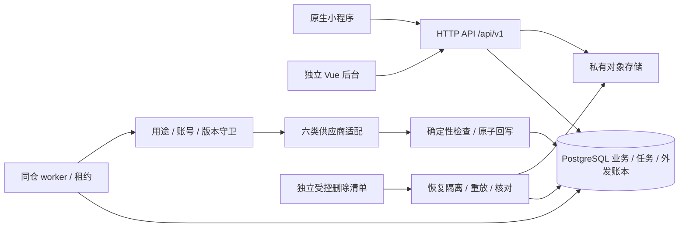

# ADR-001 初版架构与契约边界

日期：2026-10-03；任务：GY-I01 / #1；需求 v1.0、开发计划 v1.1。状态：**提交监工审查，尚未冻结生效**。契约版本 `1.0.0`，不是应用发布版本。

## 决策与范围

用户端采用原生微信小程序 `miniprogram/`（WXML/WXSS/JavaScript），五 Tab 按需求；独立网页后台 `apps/admin/`。两端只调用 HTTPS `/api/v1`，不打包供应商 SDK、AppSecret 或数据库客户端。参考工程壳提交 `9ce307fe6745b49b89774a380c37b748822df934` 的目录由 GY-I02 单独整合，本 PR 不复制旧策划和代码。

服务端 `services/api/` 为 Node.js / TypeScript / Fastify 模块化单体，同仓 worker；PostgreSQL 保存业务和持久任务，私有对象存储保存媒体。初版不要求 Redis、微服务、GPU、向量库。API、worker 独立进程可分别扩容，任务抢占依数据库租约，不靠进程内定时器保持一致性。检索先结构化条件和词典，检索后模型不能解除规则。

首版实现账号、单档案、资料和确定性过滤、拍草、OCR、ASR/文字问答/TTS、真实 AI 社区、收藏历史、应用内消息、独立后台与隐私删除。人工入口只显示建设中，不提供放行接口。二月的人审投票申诉、使用计划反馈、专家预警、报告、组织合作、沙箱支付和语音导航仅保留需求规划，本契约没有这些路由或可启用的角色。

## 版本与兼容证据

| 项目 | 选择 / 证据 | 冻结门槛与未验证项 |
| --- | --- | --- |
| Node / npm | 本机实测 `24.16.0` / `11.13.0`；[官方该版本](https://nodejs.org/en/download/archive/v24.16.0) | GY-I02 固定安装和 CI，不能靠本机有 Node 声称应用构建通过 |
| TypeScript / Fastify | TS 编译服务端；Fastify 5。[官方迁移约束](https://fastify.dev/docs/v5.0.x/Guides/Migration-Guide-V5/) 要求 Node 20+；[支持策略](https://fastify.dev/docs/v5.10.x/Reference/LTS/) | 精确包版本及锁文件见后续兼容记录；必须干净安装、类型检查、API inject、插件验证后冻结，未声称 Node24 与所有插件已实测 |
| Vue / Vite | Vue 3 独立后台；Vite。[Vite Node 要求](https://vite.dev/guide/) 与本机 Node24 主版本相容 | `vue` / `@vue/compiler-sfc` 必须同补丁版本，plugin-vue 的 peer 必须满足；候选版本不是已构建证明 |
| PostgreSQL | 候选 `17.11`，官方[发布日期 2026-08-13](https://www.postgresql.org/docs/release/17.11/)；不宣称已连接 | GY-I25 确认实际数据库版本、备份及删除能力；GY-I02 执行迁移；外部资料数据库通过适配器，不假定与业务库同型 |
| 微信 | 基础库目标 `3.17.3`，用户确认当前可选最新版本；原生工程；`3.5.5`保留为历史未验证候选 | 正式稳定标签仍待独立工具核查；GY-I02/25 实测工具精确版本、SDKVersion、编译、AppID、隐私声明、域名及双平台录音播放，配置目标、测试号和关闭校验不能替代完整冻结 |
| OpenAPI | `3.1.1`，JSON Schema 2020-12；[官方规范](https://spec.openapis.org/oas/v3.1.1.html) | [Fastify 验证机制](https://fastify.dev/docs/v5.10.x/Reference/Validation-and-Serialization/)与 OpenAPI 文件不是直接互换；GY-I02 使用受控转换或支持2020-12的validator并验 nullable/oneOf；禁止把不可信 schema 编译执行 |

配置值只在服务端安全配置：`WECHAT_APP_ID`、`WECHAT_APP_SECRET`、`DATABASE_URL`、`OBJECT_STORAGE_*`、`SESSION_SIGNING_KEY`、`DELETION_LEDGER_KEY`、`PROVIDER_<CAPABILITY>_*`。客户端只有 API base URL 和公开 AppID。配置 schema、锁文件和运行命令归 GY-I02；具体供应商版本、格式、签名、额度、留存及确认删除能力归 GY-I25。无安全外发守卫 GY-I27 时不得接真实用户媒体。

已从npm官方注册表读取不晚于2026-10-03发布的候选：Fastify5.12.5、TypeScript5.9.3、Vue3.5.43、Vite7.3.6、plugin-vue6.0.9、pg8.23.1；engine/peer元数据见[精确候选与证据状态](../../packages/contracts/runtime-baseline.json)。TS5选保守兼容分支，不声称为最新版；compiler-sfc与Vue同版。元数据范围允许Node24不等于实际依赖兼容通过；临时干净安装与标准验证结果见[验证记录](validation.md)。最终运行锁归GY-I02，在GY-I25反馈实际平台后审查冻结。

## 模块与权责

| 模块 | 权责 / 消费者 | 不可越过的边界 |
| --- | --- | --- |
| identity / privacy | 微信服务端交换、独立管理员会话、单档案、授权、撤销和删除 | 客户端不传 openid / owner / role；账号和用途 epoch 阻止旧在途写入 |
| catalog / policy | 作物、物种、资料版本、登记制剂、适用与限制规则、原文卡片 | 来源科研/经验/混合与真实/种子/模拟分别建模；登记和制剂不能用药名近似替代 |
| media / jobs | 私有上传完成校验、EXIF去除、短效访问、租约和取消 | 上传不能等于公开；媒体状态 ready 前不能外发；不可信 URL 不由 worker 任意抓取 |
| recognition / speech / qa | 供应商适配、原始候选及校正、ASR确认、检索和回答检查 | 用户校正不覆写模型指标；不输出未检查流；TTS只读取已检查版本 |
| community / moderation | 不可变内容版本、文字图片筛查、可见性、点赞举报 | 编辑即时撤旧公开版本；旧回调不发布新版本；失败隔离，管理员无绕过硬规则放行 |
| favorites / history / messages | 用户归属、事件去重、失效引用、已读 | 下架和注销使列表、缓存、详情、签名媒体及旧消息同时失效 |
| admin / audit | 来源、账号停用、任务状态、限制规则及开关，最小权限 | 不开放私有媒体和会话全文浏览；角色配置不等于农技资格；紧急停用只能收紧 |

本 PR 的 HTTP 数据形状见 [OpenAPI](../../packages/contracts/openapi.json)，持久化及约束见[数据字典](data-dictionary.md)，行为见[状态与协议](state-contract.md)，F/AC 和交接见[映射](acceptance-map.md)。以上为共同契约，不能由任一端另造枚举。

## 环境、适配与删除

服务端启动配置 `real`、`stub`、`preset_demo` 三种模式，响应 `meta.execution_mode` 必填，来源另有 `source_kind`。请求没有模式切换字段；生产/体验版真实路径不得接受客户端降级指令，替身数据库和存储与真实环境隔离。真实失败保留输入并返回错误；预设必须由用户明确进入演示兜底且显示标记，不计能力验收。

六类适配器为 weed/OCR/ASR/TTS/LLM/moderation，内部输入仅分配的最小快照；输出包含能力、供应商/模型/SDK版本、请求引用、耗时、用量、原始结果受限索引、结构结果和错误类别。供应商 callback 只允许服务端受信端点并验签，不在客户端 OpenAPI 开放；回调必须核对 job revision、lease token、账号/授权 epoch 和删除清单。无供应商幂等时，不自动重试结果未知的计费调用，记录 `provider_outcome_unknown` 待核对。

首版训练关闭，无训练端点。注销在线7日、备份30日；外发请求与确认删除分开。删除清单独立于可恢复的业务数据库，恢复先隔离网络/worker并重放清单，验证后开流量。公开帖评保留的作者使用随机不可反查注销引用，映射销毁；正文脱敏失败保持隔离、附件无法可靠处理则移除。此处冻结实施协议，实际运维演练归 GY-I19/24。

## 变更与迁移

`1.0.0` 在监工确认并合并前均为提案；本轮标记`x-proposal-revision=2`，取代旧HEAD f6b4497的缺项，不宣称已冻结版本兼容。下游可使用替身并行，不算前置验收完成。冻结后新增可选字段走 minor，纠错走 patch，删除/重命名字段、枚举语义、权限、单位或状态转移变化走 major 与 `/api/v2`，须同 PR 更新小程序、后台、适配器和验证案例。不用新增 enum 值假装无影响；所有消费者需验证 unknown enum 行为。

修订2在原提案新增Post.media、Author.revision/avatar_media与受控社区授权/取图操作；保留旧media_ids/avatar_media_id和owner私有接口，显式区分内容/媒体/作者版本。Post新增必填nullable关联引用及安全状态投影，PostInput关联类型收窄并允许显式null。GY-I02的序列化/契约替身、GY-I06的媒体网关、GY-I04的现有可选头像投影、GY-I15的帖子/评论读取与编辑、GY-I26的图片和失效关联UI、GY-I27的epoch/撤销消费者需同步更新；旧客户端不能仅靠media_id猜版本。未上线、无数据迁移执行；GY-I02的0001须包含新增引用版本/grant字段。提案回退时对应消费者和fixture共同回退，但不放宽权限或恢复旧裸链接。

当前无应用库、无上线消费者，所以本 PR 不执行数据库迁移。GY-I02 初始迁移编号 `0001` 按字典实现并测试；后续采用 expand → backfill → 双读验证 → contract，迁移 hash 记录不可篡改，数据回滚不恢复已注销身份/媒体。读旧来源版本只能追溯，不能绕过当前有效性。架构替换必须交 ADR、消费者和数据迁移/回滚证据，不能变更已确认业务范围。
