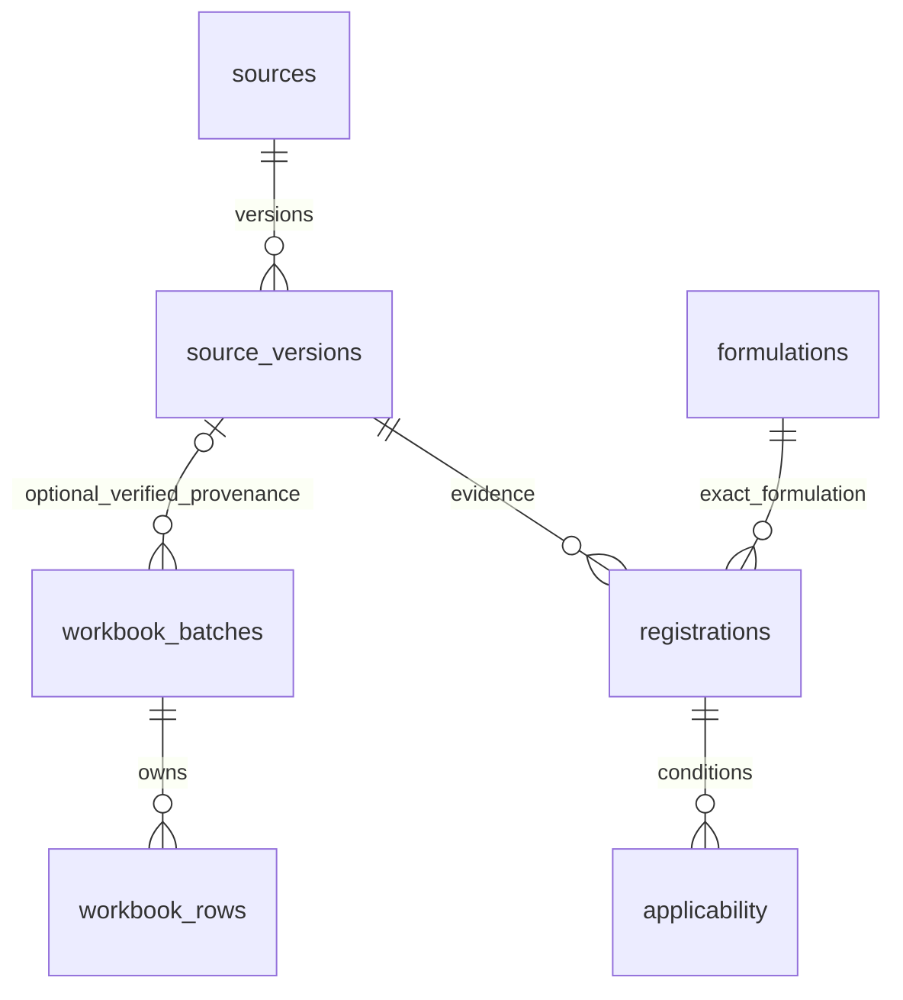

# Excel资料暂存与数据库增量设计

2026-10-08，Refs #27 / #3。依据需求v1.0、已审数据字典、0001及0002；开发基线main `2eb495ffe5d698b28dc8e97fa1dbec4096f6cbf5`。本增量不重写PR #44，不实现完整药剂安全验收或GY-I27。0003留给尚待审PR #45，资料暂存迁移用0004，独立于隐私表。

## 实际资料与映射

用户提供《市面常见除草剂环境风险与适用信息汇总表.xlsx》，SHA256 `c4905d850b3750c712b10fd8278b5029448a651308fb92c186df604a527c9e70`。只读OOXML检查得到：

| 工作表 | 实际范围与内容 | 检查结果 |
| --- | --- | --- |
| 除草剂汇总表 | A1:F97；标题1行、资料96行 | 六列全有值，NFKC/首尾空白规范化名称重复组0 |
| 说明与使用提示 | A1:A23；19行有内容 | 保存原Excel行号，空白间隔不压缩重编号 |

无合并单元格、公式、公式缓存待计算项、批注关系部件、宏或externalLinks部件；不执行宏、公式、外部链接或文件内指令。所有表均可见。实际六列表头及映射：

| Excel列 / 原表头 | 未审核映射字段 | 规范化边界 |
| --- | --- | --- |
| A / 除草剂名称 | name_text；另存name_search | 原文完整保留；name_search仅NFKC/首尾空白规范化，不能推断成分、登记号或制剂 |
| B / 常见别称／商品名 | aliases_text | 不自动拆分或作为登记精确匹配键 |
| C / 对环境危害等级 | risk_grade_text | 保留汇总表自定等级，不转权威毒性分级或安全分数 |
| D / 对环境主要造成的危害 | risk_text | 自由文本原文，不自动拆成定量环境风险证据 |
| E / 常用于防除的对象（杂草） | weed_text | 自由文本；不自动链接规范物种或推出可用性 |
| F / 适用／常用地区 | region_text | 混有地区/作物带/禁限用叙述，不自动生成浙江适用条件或禁限用法规 |

表内说明明确按具体登记/标签核对、等级为参考口径。它是用户汇总来源，不自动等于权威标签。抽样第2、3及97行均无独立登记号、成分浓度、制剂剂型、登记有效期、来源链接、标签原文、施用剂量/单位字段；缺的是列/证据，不是六列空值。96行这些规范字段均保持null，validity=unknown、review_status=unverified、card_ready=false。表内自然语言数字/百分数不做单位或剂量转换。来源许可和原文再发布未确认，原xlsx、JSON、SQL、说明原文仅留本地忽略目录，不提交公共资料种子。

## ERD及已有规范链路

新表位于knowledge_staging，已有sources/source_versions、formulations/registrations/applicability仍在public。不新建“商品名等于成分”的关系，也不覆盖0002 ingredients JSON的已审结构。本阶段仅暂存；source_version_id默认null，未来有真实出处且完成登记/制剂/条件/有效性/标签核验后，才可由独立审查的后续提升流程关联既有不可变来源版本与精确制剂。环境风险各维度的原文、单位、试验条件、出处应从后续真实证据分别版本化，不从当前等级或药名推导。当前资料不能进入v_active_source_version、v_knowledge_applicability或用量卡。

| 新表 / 字段 | 类型与约束 | 作用 |
| --- | --- | --- |
| workbook_batches.id | uuid PK | 文件哈希＋映射版本确定性UUID；相同文件/映射重导入同批 |
| file_sha256 / mapping_version | char(64) SHA256检查 / 非空text；联合unique | 内容与映射版本身份，不用文件名去重 |
| filename / imported_at | 非空text / timestamptz默认now | 只存文件名，不存微信聊天目录或账号路径；首次实际DB插入时间与本地extracted_at分开 |
| quality | object JSONB | 脱敏质量计数，无整表内容 |
| source_version_id | 可空uuid FK已有source_versions | 未知保持null，不伪造可访问来源URL/valid |
| workbook_rows.batch_id / sheet_name / excel_row | FK批次 / 非空text / positive integer；复合PK | 可追溯到原工作表和原始Excel行；批次删除只级联本批暂存行 |
| row_hash / raw | char(64) SHA256检查 / object JSONB NOT NULL | 每个单元格坐标、存储类型、值、公式及缓存、样式号；原文留本地/受控库 |
| mapped / state / issues | object JSONB / context、unreviewed、quarantined / array JSONB | 仅六字段暂存投影与检索名；缺值、重复、公式、错误值、未知列隔离；CHECK禁止把暂存行标成valid/verified/card_ready |

原始暂存JSON具有审计用途，不替代已有规范实体的FK和唯一约束。导入按单事务、批次advisory锁及唯一键幂等，缺字段或重名行保留原文但quarantined；报告在私密staging.json的issues及quality。说明页和标题存context，不当药剂行。坏表头、宏/外链部件或汇总表合并结构拒绝整批。后续映射变更须升版本，不覆写旧行。

## 服务、安全与运行

小程序只经后端API访问既有规范资料，不能直连PG、读取暂存raw或接收数据库凭据。本阶段不增加公开端点，不把原始暂存资料给LLM。迁移角色拥有DDL；应用角色不授予knowledge_staging的USAGE或表权限。专用导入角色只授予USAGE、SELECT、INSERT；回滚操作用另外受控运维角色。只读审查角色仅USAGE、SELECT，无UPDATE/DELETE。迁移显式撤销PUBLIC schema/表权限；现有私有媒体/用户/任务/撤回删除由已审契约及#45消费者实现，资料暂存没有用户媒体/任务的复制关系。本任务不借用资料schema规避用途授权，也不实现全部隐私模块。

数据库仍为PostgreSQL17，不改变大版本。大图片/音频仍只存私有对象存储引用，不引入Redis/向量库。DDL采用新增schema/table，无修改既有列，0004 down仅删自己的两表及空schema，不用CASCADE伤及他人结构。资料提升后若有新引用，回滚流程须先核验/隔离，不能强制删除证据。

1. 只读抽取：`python tools/knowledge/import_workbook_staging.py <用户xlsx路径> --output .local/<新目录>`。只允许本repo .local内新目录，拒绝覆盖；输出staging.json、import.sql、rollback.sql，全部Git忽略。源xlsx原地保留。
2. 服务端私密连接配置由既有DATABASE_URL安全路径管理。psql使用用户已设好的libpq环境或私密服务文件/pgpass，不在命令、PR、日志或小程序粘贴密码；本工具不读取现有AI密钥。生产连接不用于验证。
3. 隔离库应用既有0001、0002及新增0004，再用`psql --set ON_ERROR_STOP=1 --file .local/<目录>/import.sql`。不要手动插入schema_migrations冒充运行器证据；正常应用走已审迁移运行器。0003合并后按它的正常顺序执行，不跳过待应用迁移。
4. 同文件可重复执行SQL，批次与行不重复。回滚用同目录rollback.sql，只删除该确定性批次，保留他人批次和所有public资料；结构down位于迁移rollback子目录，不被上迁移扫描。

## 验证与精确环境缺项

实际Excel的本地抽取已完成；4组标准库离线测试覆盖OOXML关系定位/原行号、缺值与重名冲突、公式缓存/错误隔离、坏表头/宏外链拒绝、SQL原文转义和确定性批次，不发网络。最终已提交导入器的私密输出路径为.local/workbook-intake-20261008-reviewed（先前辅助检查副本为.local/workbook-intake-20261008-final），源文件SHA256不变。

30组原有工程单元检查、API/后台类型检查及仓库卫生扫描通过。PGlite辅助执行0001→0002→0004并将实际私密SQL执行两次，最终暂存116行（1行表头＋96行资料＋19行说明），未重复；该辅助检查不是目标PG17实库。本次不提交原始内容或该私密SQL。

本机PATH未发现psql/postgres/initdb/docker，常见C盘Program Files及D/E PostgreSQL目录未发现可用安装；尚无本地真实PG17或获准私密连接，因此不声称本地入库成功。新增独立CI采用隔离PostgreSQL17服务，打印实际server_version精确patch，执行旧+新迁移、合成导入两次、FK/NULL/安全字段/行号负例、应用无权限及审查只读越权负例、只回滚自己批次且保留另一批次、结构down仍保留旧sources。CI用纯合成资料，不上传用户xlsx或原文。CI结果须以具体运行成功后记录，配置workflow本身不是实测证据；PGlite也不能替代真实PG17。

实际CI证据：固定代码SHA `bf1fc726f4bfaf2821c4523a41bf4b1806a38083`，[真实PG17运行](https://github.com/Sek1ro-oka/GengYun/actions/runs/37651641219)已success，日志server_version为`17.11 (Debian 17.11-1.pgdg13+2)`，上述迁移/幂等/约束/权限/回滚检查全部通过；[工程六项检查](https://github.com/Sek1ro-oka/GengYun/actions/runs/37651641185)及[文档检查](https://github.com/Sek1ro-oka/GengYun/actions/runs/37651640948)全部success。这证明合成隔离CI的真实PG17结构与行为，不宣称本机已安装PG或已将用户原文上传到CI；本次仅文档补充不改变该代码证据。

后续本地/部署接入的最小缺项是获准的隔离PG17运行环境及服务端安全连接位置；不要求购云资源。来源/登记/标签核验、原文再发布许可及完整安全验收仍缺，不以导入成功结项。

## PR #51追溯整改

监工对旧HEAD `aadf8cb135b04c5ef270fb29c16411cbb5b29dc9`的[正式审查](https://github.com/Sek1ro-oka/GengYun/pull/51#pullrequestreview-5445679639)与[行内P2意见](https://github.com/Sek1ro-oka/GengYun/pull/51#discussion_r4209712275)结论为需修改、未合并。旧实现先read_bytes取哈希再按路径打开ZIP，文件替换可混绑A哈希与B内容；原有CI成功没有覆盖这个负例。

现为一次open读取至多25,000,001字节，超过25,000,000立即拒绝；大小校验、SHA256和BytesIO ZIP解析共同使用同一不可变bytes，不再重新打开路径。即使读取后路径变成B，该次仍解析A快照、使用A哈希；下一次独立读取B才生成B的批次。没有依赖mtime/stat断言，没有修改映射版本/既有批次/来源hash或原文件，不用修复追认历史抽取的字节一致性。本次仅使用合成工作簿，不读取或改写用户xlsx。

新增确定性回归在唯一读取返回A后立即将合成路径替换为B。对旧SHA执行同一回归，明确在名称断言得到synthetic B而失败；新实现6组Python检查全部通过，验证A哈希/A原始行/同一批次与行hash，随后B拥有自己的哈希和批次。坏ZIP不生成成功输出目录，过大输入有上限拒绝且原文件保持。真实PG17检查新增“插入新批次后触发NULL约束错误→ROLLBACK”的事务负例，要求失败批次不存在、既有原始行逐项不变；原有重复导入、权限与批次/结构回滚检查保留。新的真实PG结果仅在实际CI完成后记录，不沿用旧SHA审查。

## 后续API→真实PG小PR清单

最新main仍为`2eb495ffe5d698b28dc8e97fa1dbec4096f6cbf5`；本机再次检查未找到PATH里的psql/postgres/initdb/docker，尚无自己的本地真实PG实例。现有services/api/src/db/pool.ts已提供max=4连接池、连接/空闲超时、SELECT 1及固定错误类别；migrate.ts已有校验和台账、advisory锁和事务。复用这些成果，不在本整改重复实现。以下只列增量，未执行部署或新增业务接口：

| 小PR | 可独立实现及验证 | 前置/保留边界 |
| --- | --- | --- |
| 隔离PG连接与角色配置样例 | 明确服务端迁移/导入/应用/只读四种角色，最小schema/表授权、连接池和参数化事务，全合成API健康/权限测试 | 使用获准隔离PG17与安全连接位置；应用不持有DDL或暂存raw权限；不得用CI连通代替本地部署证据 |
| 服务端暂存导入操作 | 单一受控事务、重复导入/失败回滚、批次审计与受限读取；复用不可变快照及既有迁移器 | 在本PR追溯阻塞通过独立审查后推进，不提供自动资料提升或公开原文端点 |
| 用途与注销守卫消费者接线 | 按已审#45接口设置会话/归属/用途epoch，事务内检查、失效及删除负例 | #45仍未合并，不接管其分支或自制第二套隐私契约；全合成媒体引用，不触碰真实用户媒体 |

实际本地连接缺项是隔离PG17的可执行环境或已有安全服务端连接位置，不需新购云实例或重索AI密钥。正式药剂资料发布仍要求来源/登记/标签及许可；所有真实AI请求继续停止。
