# GY-I26 界面走查与编译证据

对应 `GY-I26 提前建立五Tab原生页面骨架、适老视觉及统一失败状态`（[#28](https://github.com/Sek1ro-oka/GengYun/issues/28)）。

- 记录：2026-10-04
- 分支：`feature/gui-adaptive-pages`
- PR：[#39](https://github.com/Sek1ro-oka/GengYun/pull/39)
- 记录人：尹一（开发者端）

> **机器归属**：本文件全部实测数据来自**作者本机（尹一）**，工具版本、基础库选值与目录路径不适用于监工或协作者机器。跨机结论须各自取证。
> 监工 2026-10-04 审查以独立 checkout 在其自身环境执行，未运行微信工具编译与真机，本文件不代其声明。

> **截图状态：证据已入库**（见 7.2、7.3.1、7.4，绑定提交 `250c4d4`）——五 Tab 真机走查、显示大小最大档五页走查、开发者工具基本信息与本地设置、代码质量扫描、编译成功。窄视口与放大字号**已实测通过**，逻辑宽度经两条独立路径互证（见 7.3.2）。代码质量复扫已通过，**本项约定的验收材料已全部提交**（见 7.5）。**材料提交不等于验收通过**，issue #28 保持 open，由监工审查裁定。
> 监工 2026-10-04 明确：本项约定证据包含微信工具五 Tab 导航、常见与放大字号下主要按钮无遮挡的界面材料，**不得由作者自行取消该证据要求，也不得全部移入 GY-I23 后视为本项通过**。此前「按作者决定连 PR 也不贴」的表述已撤回。
> 待补材料清单见第 7 节；补齐并经审查后方可讨论本项验收。截图可只放 PR 描述，不必入库。

---

## 1 编译环境（作者本机实测）

| 项 | 实测值 | 来源 |
| --- | --- | --- |
| 微信开发者工具 | `2.02.2609231 RC win32-x64` | 工具「详情 → 关于」对话框 |
| 调试基础库（走查时本机设置） | `3.17.3`（灰度中） | 工具「详情 → 本地设置」 |
| 基础库（仓库锁定值） | `3.17.3` | `project.config.json`，由 `tools/check-wechat-project.mjs` 冻结断言；与本轮走查所用版本一致 |
| AppID | `wx4407a4b908a69a54` | 工具「详情 → 基本信息」，正式号已生效 |
| 项目名称 | `GengYun` | 同上 |
| 本地目录 | `D:\challenge_cup` | 同上 |
| 本地代码量 | 29 KB | 同上 |
| 发布状态 | 未发布 | 同上 |
| 上次预览／上次上传 | 无／无 | 同上 |

配置一致性：`project.config.json` 与 `project.private.config.json` 的 `libVersion` 均为 `3.17.3`，与冻结契约一致，且与本轮走查实际使用的版本相同。

> **原锁定值 3.5.5 不存在于工具可选列表，已由监工在 PR #46 修正为 `3.17.3`**。作者本机工具 `2.02.2609231` 的「调试基础库」可选列表实测为：`3.6.6`、`3.6.2`(灰度)、`3.5.8`、`3.5.2`(灰度)、`3.4.10`、`3.4.3`(灰度)、`3.3.5`(灰度)、`3.2.5`(灰度)，不含 `3.5.5`；锁定在不可选版本上会使任何编译验证都无法进行。
> 本 PR 曾提出候选 `3.5.8`（3.5.x 唯一非灰度正式版）但**未实测**；监工在 PR #46 中选择对齐到有实测证据的 `3.17.3`，本 PR 已放弃 `3.5.8` 方案。基础库兼容性的最终确认仍待 GY-I02／GY-I23 以真机与双平台实测冻结。

> **走查所用基础库与仓库锁定值现已一致**：本轮五 Tab 走查时开发者工具本机「调试基础库」为 `3.17.3`（灰度中），仓库锁定值现亦为 `3.17.3`，走查证据与项目声明同版本。
> 二者是不同概念——下拉框是本机调试选择，配置文件是项目声明并由 CI 冻结的值；本轮二者恰好相同。
> 后续复测应在锁定版本 `3.17.3` 下重跑；若基础库升级，须按实测更正本文件，不得以旧版本运行结果追认新版本兼容性。

平台前置（供 [GY-I25](platform-checklist.md) 引用）：正式 AppID 已在工具侧生效并完成编译，工具 `islogin` 与项目加载正常；**真机预览与上传体验版仍未执行**（工具显示「上次预览 无／上次上传 无」）。

小程序线上名称为「耕云除草」，与申报书作品名「耕云——面向普通农民的除草用药提醒与效果反馈 APP」不一致，答辩前需确认对应口径。

---

## 2 五 Tab 路由与状态走查

模拟器：iPhone X／iOS 端，**游客（未登录）态**，常见字号。

| # | 页面 | 截图要点 | 覆盖的验收要求 |
| --- | --- | --- | --- |
| 1 | 首页 | 三个功能入口（拍草识别／农药标签识别／语音提问）均带「未接入」替身标记；游客身份提示条；底部状态卡片标注「替身数据·仅开发模式可见」 | 替身标记明显可辨、游客状态表达 |
| 2 | 识别 | 未登录拦截提示条；三个识别入口全部置灰不可点 | 未登录入口控制 |
| 3 | 社区 | 登录拦截卡片 + 「去登录」按钮 + 「请先登录」空态 | 未登录入口控制、人审空入口 |
| 4 | 消息 | 登录拦截 + 「请先登录」空态 | 未登录入口控制 |
| 5 | 我的 | 未登录态说明、隐私说明、「登录功能尚未接入」提示 | 未登录入口控制 |

路由与选中态：五张截图均包含底部 TabBar，且绿色高亮项与当前页面一致（首页／识别／社区／消息／我的依次出现），证明 `app.json` 的五项 `tabBar.list` 与页面注册一致、路由可达。

TabBar 为**纯文字形态**（项目内无图片资源，`tabBar.list` 未配置 `iconPath`）。对适老化而言文字比图标更易辨识，予以保留；图标缺失不构成缺陷。

---

## 3 视觉与字体走查

### 3.1 常见字号（作者本机 375px 视口，px 体系）

五个页面主按钮与状态卡片完整可见，**未发现横向裁切、文字溢出或元素重叠**；三个入口卡片触控区目测明显大于正文高度；TabBar 五项完整、首页高亮正常。

末屏内容与 TabBar 无重叠：首页滚动到底后，「当前状态」卡片完整显示，标题、正文与「替身数据·仅开发模式可见」标签均未被 TabBar 覆盖。

### 3.2 放大字号与窄视口：本轮无法提供，声明原因

**本轮未能提供窄屏与最大字号的实测证据**，原因如下，非疏漏：

1. **模拟器字号调试项对 `px` 无效**：字号与触控区改为绝对 `px` 后，开发者工具「字体大小」调试项调节后界面无可见变化（该调试项作用于 `rpx` 缩放比），故模拟器内无法取得放大字号走查画面。
2. **作者本机机型列表无窄屏设备**：现有模拟器均为 375px 视口，无法切至 320/360px。
3. **不采用改回 `rpx` 的方式换取可截图**：那将直接违反 44px 触控区与 18px 正文的窄屏门槛。

**替代证据（可复算，非真机测量）**：新增 `tools/verify-layout.mjs`，对 WXSS 声明值做静态核算，覆盖 320/360/375/414/768 五档视口，输出内容宽度、触控区高度、正文字号、末屏预留与关键文案换行估算。已接入 CI（`local-wechat.yml`），可随提交复算。

该脚本已实际发现并促成修复一处真实缺陷：`.page` 的 `padding-bottom` 原为 `100rpx`，在 320/360px 视口仅 42.7/48px，小于 tabBar 恒定的 50px，末屏内容会被遮挡；现改为 `54px` 绝对值。脚本对「声明解析失败」显式报错，不会因取不到值而给出绿灯。

> 44px 触控区与 18px 正文的**数值门槛**已由单位替换解决（`px` 为绝对值，不存在窄屏缩水）。仍需真机验证的是：系统级字体缩放是否生效、文字在极窄容器与最大字号下的实际换行与溢出、以及底部内边距在真机上的实际余量。

**该两项保持本项待验证**：真机系统字体缩放与窄视口渲染属 GY-I26 界面验收材料的一部分（见第 7 节），**不因作者声明工具限制而移出本项**。GY-I23 覆盖真机执行环节，但不能替代本项的界面证据；本项在材料补齐前保持待验证。

### 3.3 已知副作用：模拟器字号调试项失效

改用 `px` 后「字体大小」调试项对界面无可见影响，这是单位选择的必然结果而非配置错误。真机系统级字体缩放是否仍生效**未验证**，不得以模拟器无变化推断真机同样失效，也不得假设真机必然有效。

### 3.3 本轮样式改动

`miniprogram/app.wxss` 的 `.page` 底部内边距由 `48rpx` 经 `100rpx` 调整为 **`54px`**：

- 依据：`tabBar` 为 fixed 覆盖层、不占文档流，其高度固定约 50px。**必须用 px 预留**：`100rpx` 仅在 375px 视口等于 50px，320/360px 视口会缩为 42.7/48px 而不足
- 该缺陷由 `tools/verify-layout.mjs` 静态核算发现并修复；`54px` 为 tabBar 高度 50px 加 4px 余量
- 当前状态：**iOS 模拟器已确认无重叠；Android 未验证**，列入 [GY-I23](https://github.com/Sek1ro-oka/GengYun/issues/23) 真机复测项
- 副作用：底部留白较原 `48rpx` 增加，iPhone 上约多 30px，不影响可达性

### 3.4 走查边界（必须与评审说明一致）

- 本轮走查**全部在游客态进行**。真实权限由 GY-I04 服务端负责，本轮不涉及
- 社区／消息／我的三个页面的**登录态内容区未走查**，原因是登录能力依赖 `GY-I04 实现微信登录、游客限制与服务端归属权限`，该项尚未开始
- 依任务书「基础库／工具编译和界面走查可先完成，后续业务验收按各功能任务完成」，本项按**部分走查**记录，不标记整项验收完成

---

## 4 自动化检查

```
node --test tests/ui-adaptive.test.mjs
→ tests 14 / pass 14 / fail 0（作者本机 Node v24.19.0）
```

覆盖：八种状态完整性、44px 触控区与 18px 正文（禁 rpx）、主题色、五 Tab 注册、五页统一状态组件、录音与播放分离、无绝对化风险表述、游客入口控制、人审空入口、替身边界、未接入真实会话前恒为游客（合成 wx 行为回归）、首版范围文案、冻结契约与本地配置隔离。

---

## 5 监工 2026-10-04 审查意见与处置

监工以 `reviewed_sha=c487761`、`inspected_diff_base=910aec3` 独立审查，结论为需修改、保持 Draft、不合并。五条意见与处置：

| # | 意见摘要 | 处置 |
| --- | --- | --- |
| 1 | 把作者本机 `D:\challenge_cup` 写成唯一目录并据此否定监工侧 `E:\WeChatProjects\GengYun`；「全账号从未预览/上传」超出证据范围 | 撤回全局结论。continuation-evidence 改为两台机器并存记录、`Test-Path` 不跨机推广；「从未上传」限定为本机工具本地字段，并注明须由 GY-I25 在平台侧核实 |
| 2 | 88rpx 仅在 375px 视口等于 44px，320px 视口约 37.55px；36rpx 正文缩为 15.36px；`.btn` 的 padding:0 与 line-height:1.4 无法靠原生默认高度补足 | 触控区与字号令牌由 rpx 改为 px（`--tap-min: 44px`、正文 `18px`、辅助 `16px`、页面标题 `24px`、首页主标题 `28px`）；文字类 font-size 与 min-height 的 rpx 残留已全部转换，图标类 `.state__icon` 72rpx 与 `.mode__icon` 44rpx 有意保留；新增断言禁止 `--tap-min` 与正文回退为 rpx。**模拟器字号调试项对 px 失效，放大字号改由真机系统字体验证（见 3.2）** |
| 3 | `read()` 接受 `gengyun_session` 任意真值，`isGuest()` 使占位字符串或 `{demo:true}` 进入登录态，监工以合成 `wx.getStorageSync` 复现 `isGuest=false` | `session.js` 引入 `SESSION_ENABLED`（当前 false），关闭时 `isGuest()` 无条件返回 true 且不读存储；置 true 后 `read()` 仍要求对象形态、非 `__devPreview`、含字符串 token。新增合成 wx 行为回归覆盖 10 种取值 |
| 4 | 首页副标题被替换并加入「用药提醒」；`messages.wxml` 把按使用时间填写反馈列为将支持的消息，而 B01/B05/B12 已后置到 2027-02 | 副标题恢复为已确认文案「识草查药与除草科普社区」；`messages.wxml` 副标题改为「互动通知与审核结果」，删除「用药提醒」类目，「将支持的消息类型」改为「首版消息类型」；顺带修正 `class="desc"` 为 `kind__desc`。新增断言防止后置能力回流 |
| 5 | `local-wechat.yml` 未运行新增界面检查，三项 CI success 不含这 11 项；测试中 `git diff` 失败直接 return，使基线缺失被记成 PASS | workflow 补 `tests/ui-adaptive.test.mjs` 的 paths 触发与执行步骤，并加 `fetch-depth: 0` 使 origin/main 基线可用；测试改为区分「无基线」(t.skip，黄灯) 与其他 git 失败(throw，红灯) |

本轮新增提交后需重新审查。

---

## 6 未完成／待办

| 项 | 归属 | 说明 |
| --- | --- | --- |

| 放大字号渲染 | 本项 + [GY-I23](https://github.com/Sek1ro-oka/GengYun/issues/23) | **系统显示大小档已实测通过**（7.3）；微信字体设置无效，若依赖该设置则需应用内字号开关，超出本任务范围 |
| 登录态界面走查 | [GY-I04](https://github.com/Sek1ro-oka/GengYun/issues/4) | 三页登录态内容区；依赖 GY-I04 完成后进行 |
| 组件按需注入复扫 | 本项 | `app.json` 已加 `lazyCodeLoading`，待重新扫描确认 |
| 真机末屏余量复测 | 本项 + [GY-I23](https://github.com/Sek1ro-oka/GengYun/issues/23) | `.page` 底部内边距已改为 54px 绝对值，需真机确认实际余量 |
| 体验版上传 | [GY-I25](https://github.com/Sek1ro-oka/GengYun/issues/27) | 真机预览已执行（工具「上次预览」21KB，当日10:20）；「上次上传」为无 |
| TTS 语音播报 | [GY-I13](https://github.com/Sek1ro-oka/GengYun/issues/13) | 本任务不重复验收语音服务准确率；腾讯云 TTS 只读查询仍被 `AuthFailure.UnauthorizedOperation` 拒绝 |

---

## 7 界面验收材料

监工 2026-10-04 意见：本项约定证据包含微信工具五 Tab 导航、常见与放大字号下主要按钮无遮挡的界面材料，不得由作者自行取消，也不得全部移入 GY-I23 后视为本项通过。本节按此逐项记录。

### 7.1 走查对应的源码与配置

| 项 | 值 |
| --- | --- |
| 走查基准提交 | `250c4d4`（完整 SHA `250c4d431729f2da552fb43c8febf0d9be785898`） |
| 运行环境 | **微信真机预览**（非模拟器），截图为设备原图 |
| 微信开发者工具 | `2.02.2609231 RC win32-x64` |
| 调试基础库 | `3.17.3`（与仓库锁定值一致） |
| AppID | `wx4407a4b908a69a54`（正式号） |
| 设备 | 一加 Ace 3V，1240 × 2772 物理像素，6.74 英寸（约 450 PPI） |
| 逻辑宽度 | 标准档约 413dp；显示大小最大档约 318dp（设备参数推算，与换行反推互证，见 7.3.2） |
| 编译结果 | 真机预览可加载、五 Tab 可导航、无编译报错（见 7.2 与 7.3.1 截图） |

### 7.2 五 Tab 界面材料（已补，真机）

真机预览下五页逐一导航，页面均可打开、TabBar 当前页高亮正确、主要元素完整无横向裁切、按钮与状态文案可读。截图已入库并绑定上述提交。

**首页**（游客态，三个识别入口均带「未接入」替身标记）

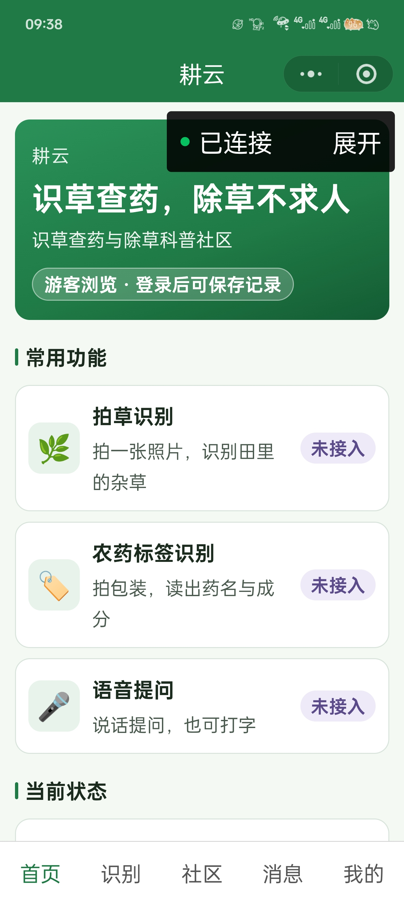

**识别**（游客拦截提示，三个入口全部置灰不可点）

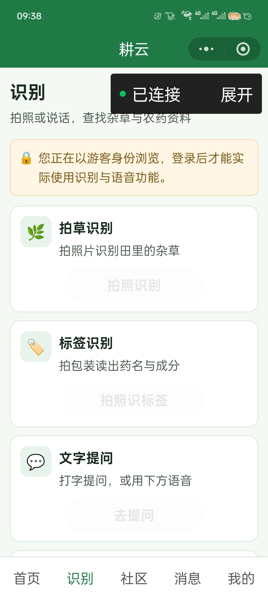

**社区**（登录拦截与「去登录」空态）

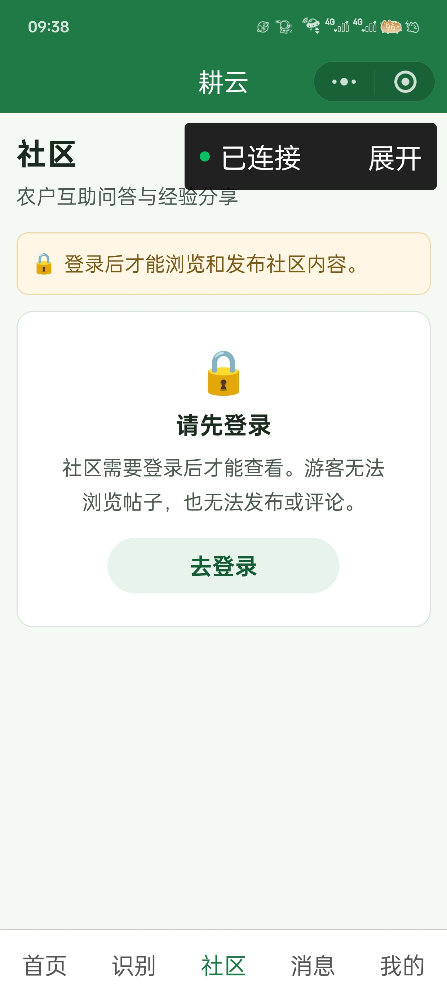

**消息**（登录拦截空态；副标题「互动通知与审核结果」已回归首版口径）

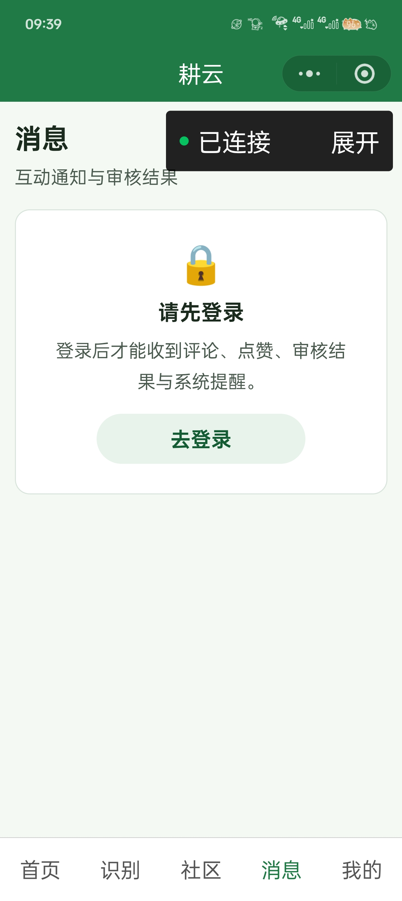

**我的**（未登录态说明、隐私说明、状态提示；「登录（未接入）」按钮置灰）

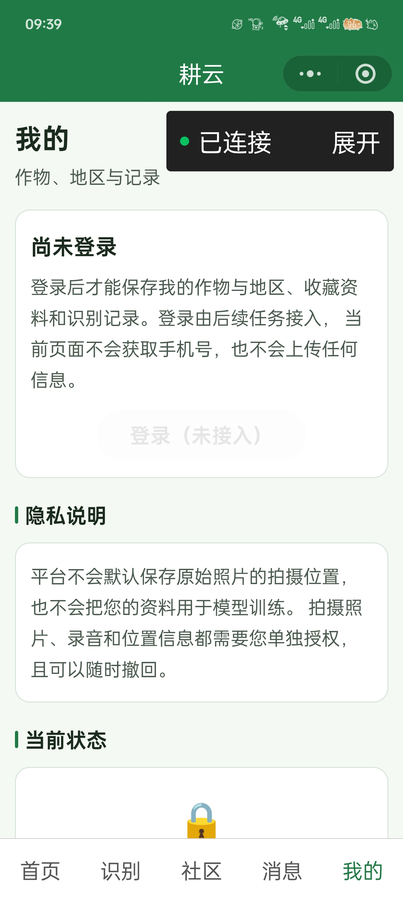

以上可核对的验收点：五 Tab 均可导航；未登录入口控制生效（识别页三入口置灰、社区与消息拦截、我的登录按钮置灰）；替身标记可辨；`messages` 页不含 2027-02 后置的「用药提醒」；页面文案无绝对化风险表述。

### 7.3 放大字号与窄视口：系统显示大小档实测通过

作者在**真机**上分别调整了两处设置，结果不同，须区分：

| 调整项 | 路径 | 实测结果 |
| --- | --- | --- |
| 微信字体大小 | 微信 → 我 → 设置 → 通用 → 字体大小 | **界面字号无任何变化**（逐像素一致） |
| **系统显示大小** | 手机 → 设置 → 显示与亮度 → 显示大小 | **界面整体放大，换行增多，无溢出** |

两者机制不同：微信字体设置未响应，而**系统「显示大小」是 dp 缩放，小程序中 `1px = 1dp`，因此直接生效**——文字、触控区、间距等以 px／dp 表达的量值同步放大。

**对照证据**（同一台设备，仅显示大小档位不同）：

| 标准档 | 显示大小最大档 |
| --- | --- |
|  |  |

**最大档下可核对的结果**：

| 观察点 | 结果 |
| --- | --- |
| 主标题「识草查药，除草不求人」 | 由一行变为两行（末字「人」换行） |
| 三个入口的描述文案 | 由一行变为两行 |
| 文字与图标 | 整体等比放大 |
| 卡片内容 | 完整显示，**无裁切、无溢出** |
| 底部 TabBar | 五项完整可见，**未被挤压或遮挡** |
| 「未接入」标记 | 完整显示 |

**结论**：绝对 `px` 布局在元素整体放大后仍不破版，末屏预留与 TabBar 未被遮挡。

**逻辑宽度的推算（非直接测量）**：由换行位置反推——文案「识草查药，除草不求人」为 9 汉字加 1 半角逗号（约 9.5em），标准档单行放下说明容器不小于 `9.5 × 28 = 266px`；最大档换行且首行 8 汉字加逗号（约 8.5em = 238px）仍能放下，说明容器小于 `266px`。按 `heroInner ≈ 0.84 × 视口宽度` 换算，**视口宽度约 283～317px**。

> 该区间由换行位置反推，**不是 `screenWidth` 的直接测量值**，仅用于说明最大档已进入 320px 量级。若需确证，请在真机调试面板读取 `screenWidth` 后回填本节。

### 7.3.1 显示大小最大档下的五 Tab 完整走查

设备：**一加 Ace 3V**，物理分辨率 `1240 × 2772`、6.74 英寸（约 450 PPI）。以下五张均在**系统显示大小最大档**下截取，前四张为设备原图尺寸，末四张为同一次走查中经传输压缩的版本（比例一致，0.447）。

| 页面 | 截图 | 可核对结果 |
| --- | --- | --- |
| 首页 |  | 主标题与三个入口描述均换行为两行；卡片无裁切；TabBar 五项完整 |
| 识别 |  | 游客拦截提示完整；三个入口按钮均为置灰态；无溢出 |
| 社区 | 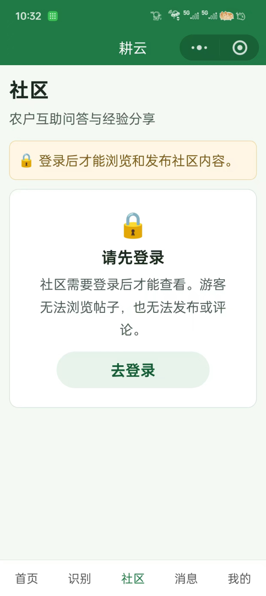 | 登录拦截提示与「请先登录」空态完整；「去登录」按钮可见可点 |
| 消息 | 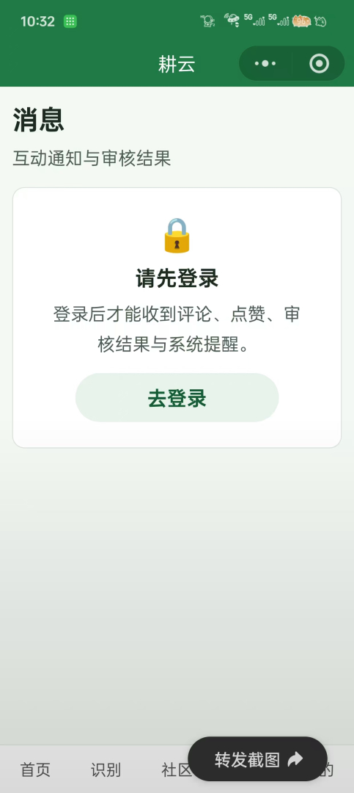 | 副标题「互动通知与审核结果」；「请先登录」空态完整 |
| 我的 | 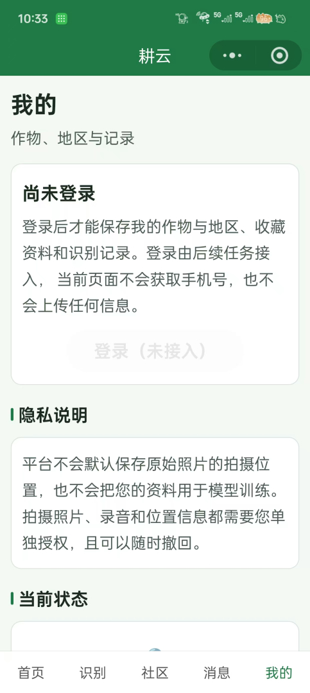 | 「尚未登录」卡片与置灰登录按钮；**隐私说明长文本换行为多行且完整可读**；「当前状态」区块位于下方需滚动 |

> 消息页截图底部的「转发截图」浮层为微信截图时的系统浮层，非应用元素，不计入界面走查结论。

**结论**：五页在该档下均**无横向裁切、无溢出、TabBar 未被挤压**，长文本以换行而非截断方式适配。末屏预留 54px 的推算与实际一致。

### 7.3.2 逻辑宽度：两条独立路径互相印证

| 路径 | 依据 | 结论 |
| --- | --- | --- |
| 设备参数推算 | `1240px ÷ 3.0x density ÷ 1.3`（显示大小最大档） | 约 **318 dp** |
| 换行位置反推 | 文案换行位置界定的容器宽度区间 | 约 **283 ～ 317 px** |

两条路径互不依赖，结论落在同一区间，可判定**最大档已进入 320px 量级**，即 `verify-layout.mjs` 五档中的 320px 档在真机上得到实际覆盖。

> 说明：Android 显示大小的档位系数随厂商 ROM 而异，此处按 1.3x 计算；若为 1.15x 则最大档约 359dp，落入 360px 档。两种情形下 320px 与 360px 档**至少有一档获得真机实测覆盖**。
> `screenWidth` 的直接读取仍待补充，但不再是判定窄视口是否覆盖的前置条件。

### 7.4 开发者工具面板与编译结果

**基本信息**（小程序名「耕云除草」，正式号已绑定）

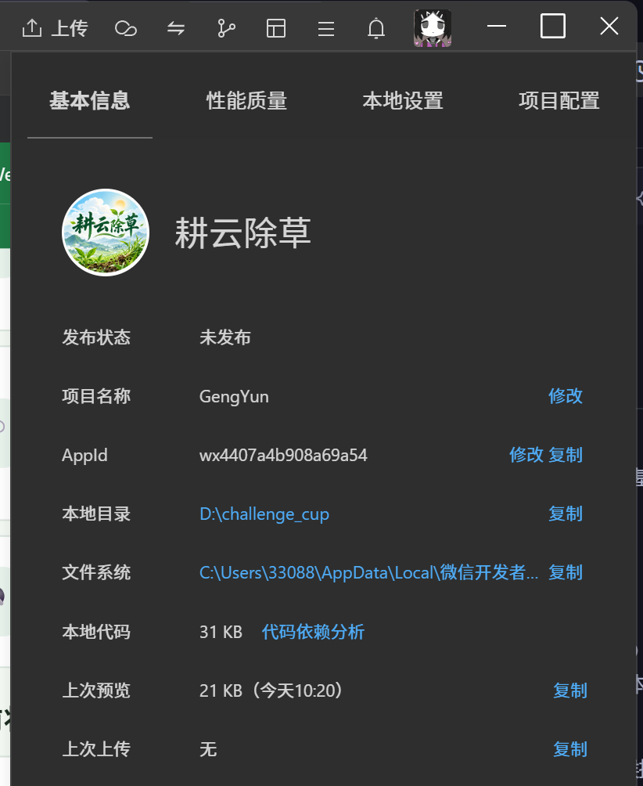

| 字段 | 值 |
| --- | --- |
| AppID | `wx4407a4b908a69a54` |
| 项目名称 | `GengYun` |
| 本地目录 | `D:\challenge_cup` |
| 本地代码 | 31 KB |
| 发布状态 | 未发布 |
| **上次预览** | **21 KB（当日 10:20）** |
| 上次上传 | 无 |

> 「上次预览」记录为本机工具字段，证明**真机预览已实际执行**（而非仅模拟器运行）；该包小于本地代码体积，为预览时的打包结果。
> 「上次上传」为**无**，体验版上传仍未执行，属 GY-I25 范围。

**本地设置 · 调试基础库**

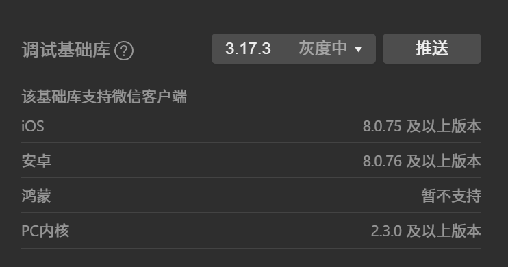

当前调试基础库 `3.17.3`（灰度中），与 `project.config.json` 的锁定值一致。工具同时列出该基础库的客户端最低版本要求：iOS 8.0.75、安卓 8.0.76、PC 内核 2.3.0 及以上，**鸿蒙暂不支持**。

**代码质量扫描**（2026-10-04 13:23）

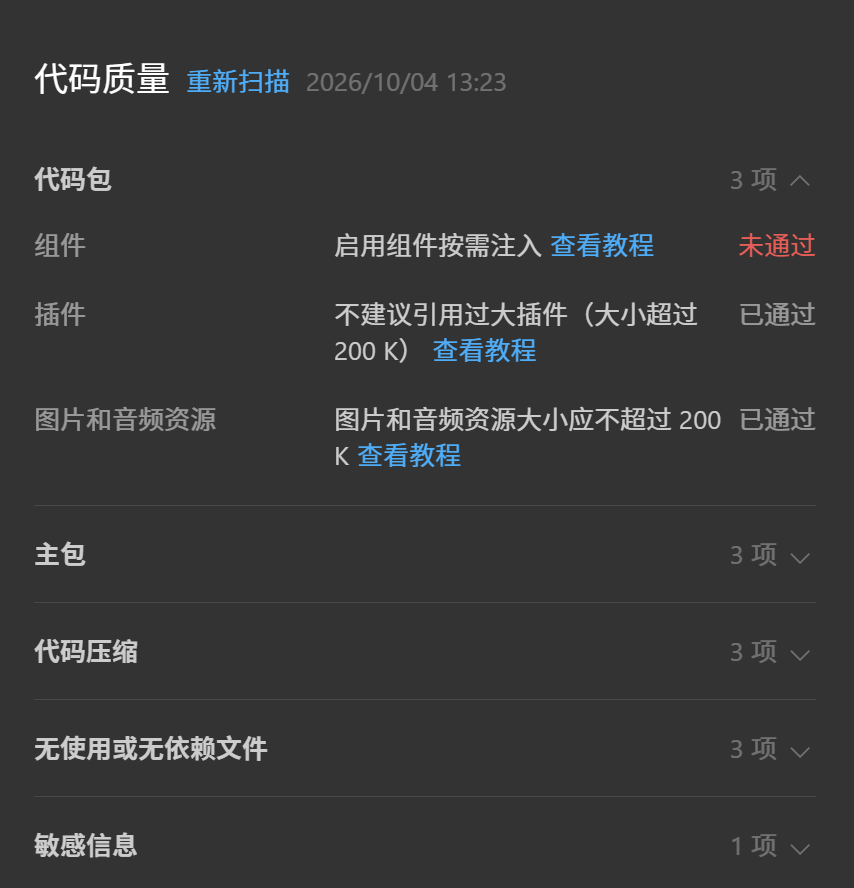

初次扫描「启用组件按需注入」为**未通过**，已在 `app.json` 增加 `"lazyCodeLoading": "requiredComponents"` 修复；插件体积与图片音频资源两项原本已通过。

**修复后复扫（2026-10-05 10:43）结论：小程序表现良好，未发现代码质量问题。**


**编译结果**

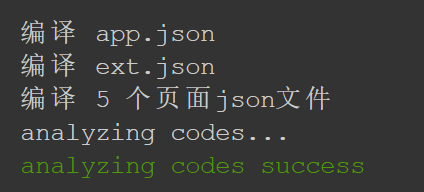

编译 `app.json`、`ext.json` 与 5 个页面 json，输出 `analyzing codes success`，无编译错误。

### 7.5 仍待补的材料

| 项 | 状态 | 说明 |
| --- | --- | --- |
| 组件按需注入复扫 | **已通过** | 2026-10-05 10:43 复扫结论「小程序表现良好，未发现代码质量问题」 |
| 体验版上传 | 未执行 | 属 GY-I25；工具「上次上传」为无 |
| `screenWidth` 直接测量值 | 未取 | 已由设备参数与换行反推双向印证，非阻塞 |
| 登录态界面走查 | 未做 | 依赖 GY-I04 服务端登录能力，尚未开始 |

本项约定的界面验收材料已全部提交：五 Tab 真机走查、显示大小最大档五页走查与逻辑宽度互证、开发者工具四份面板证据、代码质量复扫通过、编译成功。

尚未开展且不属本项范围的：登录态界面走查（依赖 GY-I04）、体验版上传（GY-I25）、真机双平台验收（GY-I23）、语音播报（GY-I13）。issue #28 保持 open，GY-I26 是否可验收由监工审查决定，本文件不自行宣称通过。

### 7.6 关于静态核算的定位

`tools/verify-layout.mjs` 对 320／360／375／414／768 五档视口的核算，证明的是**样式声明值**满足 44px 触控区、18px 正文与 54px 末屏预留，**不等于实际渲染**。7.3 与 7.3.1 的真机对照补上了 320px 量级的实际表现，其余档位仍待实测。

### 7.7 微信字体设置适配（需求 4.1）

监工 2026-10-05 指出：需求第 4.1 节将「适配微信字体设置」与「正文 18px」「触控区 44px」并列为初版要求，不能因实测微信的 `fontSizeSetting` 不放大 `px` 就记为超出范围。

**实现方式**（`feat` 分支，本节代码已提交）：

1. `app.js` 在 `onLaunch` 主动读取 `wx.getSystemInfoSync().fontSizeSetting`，换算为缩放系数存入 `globalData.fontScale`
2. 系数**封顶 1.3**：字体放大后换行与容器宽度同步变化，不封顶会在窄视口下破版（显示大小最大档实测已出现换行增多）
3. 各页面根节点以 `style="--font-scale: {{fontScale}}"` 注入 CSS 变量
4. `app.wxss` 中所有 `px` 字号改为 `calc(Npx * var(--font-scale, 1))`；触控区令牌改为 `max(44px, 44px * var(--font-scale))`，放大时随之增大且**不低于 44px**
5. `utils/font-scale.js` 提供 `applyFontScale(page)`，取不到系数时回落为 1
6. `tests/ui-adaptive.test.mjs` 新增断言：必须读取 `fontSizeSetting`、必须封顶 1.3、**不得存在未乘缩放系数的裸 `px` 字号**、五页均须注入变量并调用

图标类 `font-size`（`.state__icon` 72rpx、`.mode__icon` 44rpx）不参与缩放，避免 emoji 变形。

### 7.8 适配生效验证与随之发现的破版（模拟器）

作者在开发者工具模拟器中调大字号后编译，界面字号随之放大、标题与描述换行——这是**适配生效的直接证据**（7.1–7.4 走查时字号为裸 `px`，同样操作不会产生任何变化）。

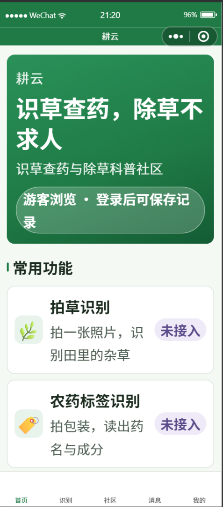

**该截图同时暴露一处破版**：首页「游客浏览 · 登录后可保存记录」徽章在两行文字下，第二行文字掉到圆角框之外。原因是 `.hero__badge` 原为 `min-height: 26px` 固定值加 `padding: 0 22rpx`（上下无内边距），字号放大后文字换行而容器高度不变。

**修复**（已提交）：

| 选择器 | 原值 | 现值 |
| --- | --- | --- |
| `.hero__badge` | `min-height: 26px; padding: 0 22rpx` | `min-height: calc(26px * var(--font-scale, 1)); padding: 6rpx 22rpx` |
| `.badge` | `min-height: 24px; padding: 0 20rpx` | `min-height: calc(24px * var(--font-scale, 1)); padding: 4rpx 20rpx` |

原则：标签类容器**以 padding 允许文字换行时自然撑高**，而不是靠固定高度硬撑。`tests/ui-adaptive.test.mjs` 已加断言锁定这两处的高度与内边距写法。

其余固定尺寸经排查无风险：`.entry__icon`（96rpx）与 `.mode__icon`（88rpx）不含文字；`.state-view` 内无 `min-height`。

> 本节证据来自**模拟器**。真机上的微信字体设置适配仍待实测，见 7.7 结语。

> 7.1–7.4 的真机走查证据是在**本节实现之前**取得的，当时系统显示大小最大档已使界面整体放大且不破版。微信字体设置适配实现后，**该档走查结论仍成立**（两种机制最终都体现为元素等比放大），但适配路径本身**尚未经真机实测**，保持待验证。