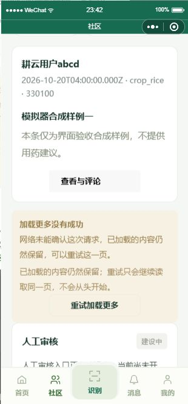
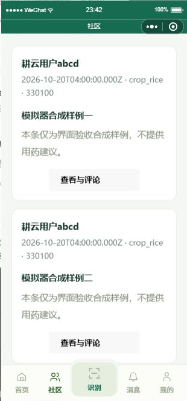

# 社区翻页失败与显式重试：模拟器证据（2026-10-24）

Refs #28；PR #556。实现绑定93bb15af5a7c59c79c812e6836becbeea5956150，本次仅补证据。

环境：微信工具CLI skill 0.3.11（已登录、版本相等）；基础库3.17.3，platform=devtools，模拟标签HUAWEI Mate70 Pro，逻辑视口376×742、pixelRatio3.5。截图310×664，为模拟器优化输出，非真机。使用原生页面真实渲染与实际事件；未用setData直接填失败/成功。

使用隔离.local/wechat-local副本，目标页面js/json/wxml/wxss SHA256均与提交源码一致；网络仅在隔离副本开启本机3110合成API。通过产品现有登录按钮建立本地synthetic会话，未伪造登录门禁；仅目标读接口使用明确合成响应，不代表真实后端或真实用户能力。测试后已恢复wx.request。未输出会话令牌、openid或微信code。

合成GET /posts首页返回1条、next_cursor=review-next-1；首次下一页返回模拟网络失败。页面保持ready、1条帖子和同一游标，持久显示失败说明及重试按钮。首次“加载更多”的自动化原生点击未触发请求，因此通过automation_page_action调用真实onLoadMore方法触发失败；不把此步骤记为初始按钮物理点击通过。

随后automation_element_action以selector=.load-more-error__retry实际tap重试组件：请求计数first=1不变、next从1到2；成功后rows从1到2、nextCursor=null、loadMoreError为空，无重复追加。本轮核看失败画面和按钮可见可点，保留已加载帖子。

边界：首次加载更多按钮实际点击未验证；401/403/INVALID_CURSOR分支复用已有64项受影响测试，不声称新增模拟器逐分支覆盖。未取得真机、多机型或真实社区联调，不关闭整项。
