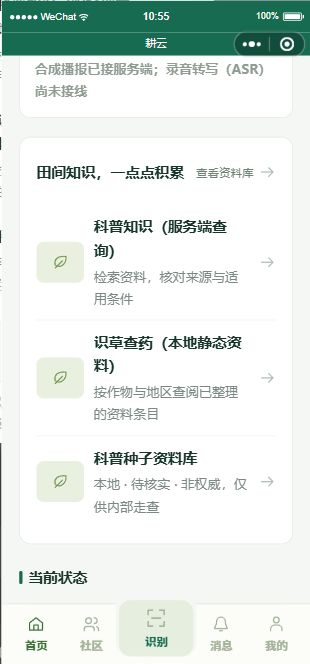
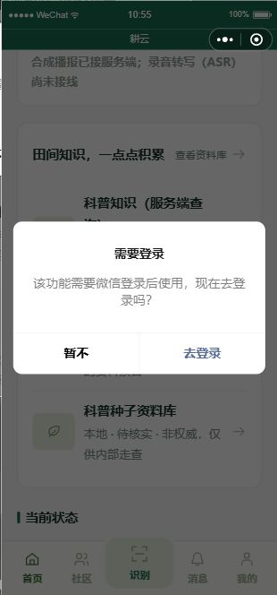

# GY-I26 首页资料入口排版修复模拟器证据

Refs #28；PR #647。2026-10-27，指挥 Codex 采集并实读截图，供独立监工审查，不是监工批准。

## 版本与工程隔离

- 受验代码提交：`87de3144244c58becabcfe9c73d73d5617ab8ccb`，首页三处 info-row 与一处 text-btn 从 button 改 view；bindtap 和门禁保留。
- 从该提交的指挥 checkout 用 `node tools/prepare-wechat.mjs release` 生成 `.local/wechat-release`，仅为隔离验证副本；默认禁用联网，不是发布验收或实际发布。
- 采集前核对生成副本的首页 js/wxml/wxss 与受验 checkout 一致；没有 setData 注入、请求 mock、业务后端或真实资料。
- 工具 skill 0.3.11，versionRelation=equal，loginExpired=false，CLI 不需要令牌。首次运行时读取超时；正常截图后再次读取 currentPage 成功，未清缓存、退出整个 IDE 或终止其他进程。

## 环境与实际步骤

- 当前页：pages/home/home；platform=devtools，SDK 3.17.3，逻辑 window 376×742，pixelRatio=3.5，fontSizeSetting=26。
- 工具型号标签为 HUAWEI Mate 70 Pro / HarmonyOS；这是模拟器标签，不是真机证据。当前 Demo 阶段验局部关键文字/操作可见，不据此登记适老或机型矩阵通过。
- simulator_screenshot 优化输出 310×664 JPEG，以下两张已逐张打开检查。
- 用 automation_viewport_action 的 pageScrollTo 滚到资料入口，截图确认三条入口正常横向铺开，标题与说明可换行、箭头在卡片内；页头标题和“查看资料库”在同一行，未见此前 184px 居中窄列及逐字竖排。
- automation_element_action size 实测首条 `.info-row` 宽 292、高约 140.98；`.text-btn` 宽 97、高 44（均为逻辑像素）。
- 实际 automation_element_action tap `.info-row` 后截图显示原生“需要登录”弹窗；currentPage 仍为 pages/home/home，没有进入知识页。此次有可见结果，计实际入口点击与游客门禁通过，不是仅凭 tap success。
- 仅实际点了首条资料入口，其他两条入口与“查看资料库”按钮未逐项点击；其 bindtap 未改，复用既有门禁测试，不冒称四项都点击通过。

## 截图

## 检查与边界

复用原代码 HEAD 的 20 项 CI 成功，以及既有工程检查和 diff --check。证据提交后补严格文档锚点检查；本次没有再次跑无关全量测试。

原本缺少修复后视觉证据的缺口现补到；当前没有修复 Hero/.btn 的额外问题，也没有验证真实 HTTP、真机、供应商或完整 #28 验收。#648 H1 公开预览是独立已合成果，本截图所用代码仍为 #647 原 HEAD，不冒称合并两片后的联合画面。#28 保持开放。
