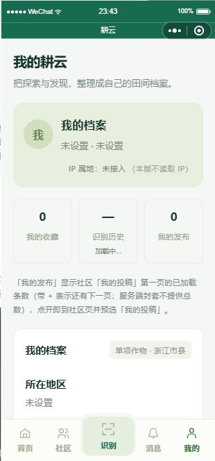
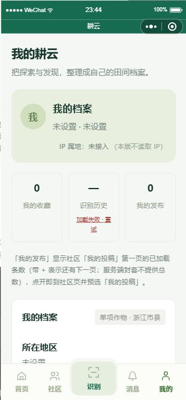
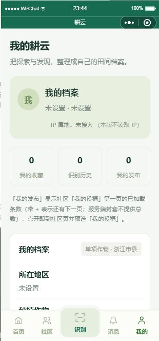

# 个人页计数独立失败与重试：模拟器证据（2026-10-24）

Refs #28；PR #557。实现绑定7c305292bd34270aef732ccd41805add560447c0，本次仅补证据。

环境：微信工具CLI skill 0.3.11（已登录、版本相等）；基础库3.17.3，platform=devtools，模拟标签HUAWEI Mate70 Pro，逻辑视口376×742、pixelRatio3.5。截图310×664，为模拟器优化输出，非真机。使用原生页面真实渲染与实际事件；未用setData直接填失败/成功。

使用隔离.local/wechat-local副本，目标页面js/json/wxml/wxss SHA256均与提交源码一致；网络仅在隔离副本开启本机3110合成API。通过产品现有登录按钮建立本地synthetic会话，未伪造登录门禁；仅目标读接口使用明确合成响应，不代表真实后端或真实用户能力。测试后已恢复wx.request。未输出会话令牌、openid或微信code。

合成收藏/我的发布读取成功空页，各显示0；历史首次延迟后模拟网络失败。截图可见加载中→加载失败·重试，其他两项保留ready/0。

实际tap `.stat__state--error[data-kind="history"]`：仍在pages/profile/profile，历史请求由1到2、其他两项各保持1；随后三项均ready/0。重试前后editing=false、cropIndex/cityIndex/countyIndex均-1，未跳转或改动档案状态。本轮未进入编辑表单，不据此推断编辑中的全场景保持。当前视口失败文字分两行但完整可见，重试实际可触发。

边界：本轮实测历史单项，其余单项与迟到响应复用34项针对性测试；合成空页0不代表真实账号没有数据。不作真机、真实总数或#28整体验收通过。
